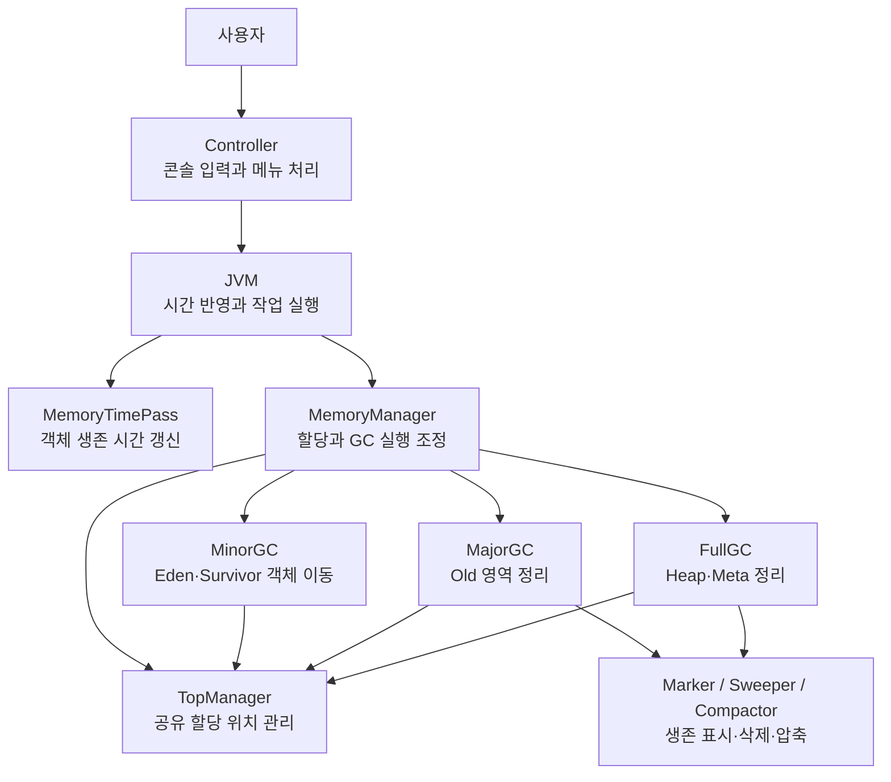
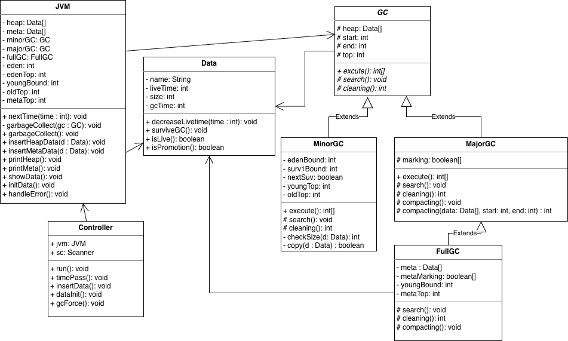
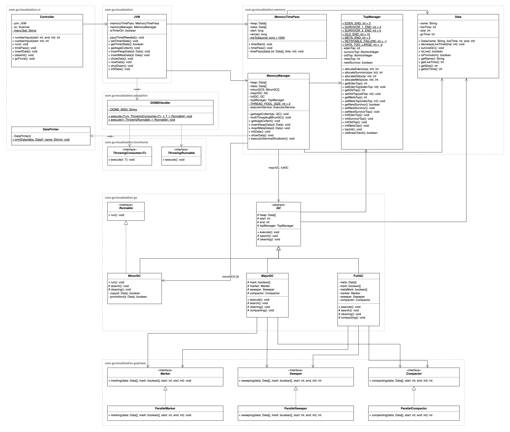

# GCVisualization

메모리를 배열로 표현하고, 객체의 할당·이동·정리를 콘솔에서 확인하는 GC 학습용 시뮬레이터입니다.

실제 JVM의 GC를 그대로 재현하기보다, 세대별 메모리 영역과 GC의 주요 작업을 단순화해 구현했습니다. 구현 과정에서는 GC별 처리 범위와 실패 판단을 분리하고, 여러 작업이 공유하는 메모리 할당 위치를 한곳에서 관리하는 구조를 다뤘습니다.

## 프로젝트 개요

이름·크기·생존 시간을 가진 객체를 메모리에 넣고, 시간이 흐르거나 GC가 실행될 때 객체가 어떻게 이동하고 정리되는지 확인할 수 있습니다.

| 기능 | 설명 |
| --- | --- |
| 객체 삽입 | 객체의 이름·크기·생존 시간을 입력해 메모리에 저장합니다. |
| 시간 경과 반영 | 타이머를 켜면 이후 작업 시 경과 시간을 반영해 객체의 남은 생존 시간을 줄입니다. |
| Minor GC | Eden과 현재 사용 중인 Survivor의 객체를 정리하고, 살아 있는 객체를 다른 Survivor 또는 Old로 이동합니다. |
| Major GC | Old 영역의 생존 표시·삭제·압축을 수행합니다. |
| Full GC | Heap과 별도 Meta 배열을 대상으로 생존 표시·삭제·압축을 수행합니다. |
| 상태 확인·초기화 | 영역별 객체 배치를 출력하거나 시뮬레이션 상태를 초기화합니다. |

## 메모리 모델과 추상화 범위

### 영역 구성

Heap은 15칸, Meta는 별도의 5칸 배열로 구성합니다. 아래 범위의 끝 인덱스는 포함하지 않습니다.

| 영역 | 배열 범위 | 크기 |
| --- | --- | --- |
| Eden | Heap `[0, 3)` | 3칸 |
| Survivor 1 | Heap `[3, 4)` | 1칸 |
| Survivor 2 | Heap `[4, 5)` | 1칸 |
| Old | Heap `[5, 15)` | 10칸 |
| Meta | 별도 배열 `[0, 5)` | 5칸 |

한 칸은 JVM의 바이트 단위 메모리가 아니라 시뮬레이션의 저장 단위입니다. 객체의 크기가 2라면 연속된 두 칸을 사용합니다. 영역 크기는 작은 입력으로 이동·정리 과정을 확인하기 위한 값이며, 실제 JVM의 기본 비율을 의미하지 않습니다.

### 구현한 범위

- 크기에 따른 연속 공간 할당과 다음 할당 위치 관리
- Eden·Survivor·Old 영역 사이의 객체 이동
- 객체의 생존 여부에 따른 표시·삭제·압축
- 두 Minor GC 작업의 병렬 실행과 공유 위치 예약
- Heap과 별도 Meta 배열을 대상으로 하는 전체 정리

### 단순화한 범위

- **객체 생존 판단:** GC Root에서의 참조 도달성 대신 입력한 생존 시간을 사용합니다.
- **객체 표현:** 실제 객체 헤더와 참조 그래프 대신 `Data`와 배열을 사용합니다.
- **시간 경과:** 별도 스레드가 계속 객체를 갱신하지 않습니다. 타이머가 켜져 있을 때 사용자 작업 시 경과 시간을 반영합니다.
- **Meta:** 실제 Metaspace와 클래스 언로딩을 재현하지 않고, 별도 배열의 데이터 정리로 표현합니다.
- **STW:** 애플리케이션 스레드 전체를 정지·재개하는 Stop-The-World 제어는 구현하지 않았습니다.

## 프로그램 구조

서버나 외부 저장소 없이 실행되는 콘솔 프로그램입니다. 아래 구조도는 주요 객체의 호출·협력 관계를 나타냅니다.



`Main`에서 배열과 처리 객체를 만들고 의존 관계를 연결합니다. 구조도의 `JVM`은 이 프로젝트의 작업 실행 클래스이며 실제 JVM을 의미하지 않습니다.

| 구성 요소 | 역할 |
| --- | --- |
| `Controller` | 입력을 받아 객체 삽입, 타이머 전환, Full GC, 초기화, 출력 등을 요청합니다. |
| `JVM` | 필요한 경우 경과 시간을 반영하고 메모리 작업과 오류 처리를 연결합니다. |
| `MemoryManager` | 객체 할당을 시도하고 공간 상황에 따라 GC를 실행합니다. |
| `MemoryTimePass` | 경과 시간만큼 객체의 남은 생존 시간을 줄입니다. |
| `MinorGC` | 살아 있는 객체를 다음 Survivor 또는 Old로 이동하고 원래 영역을 정리합니다. |
| `MajorGC` / `FullGC` | GC별 대상 영역과 실행 순서, 공간 부족 판단을 담당합니다. |
| `Marker` / `Sweeper` / `Compactor` | 생존 표시, 죽은 객체 삭제, 빈 공간 압축을 각각 담당합니다. |
| `TopManager` | 영역별 다음 할당 위치와 Survivor 전환 상태를 공유합니다. |

Minor GC에서는 Eden과 현재 사용 중인 Survivor를 처리하는 두 작업을 병렬로 실행합니다. `ParallelMarker`, `ParallelSweeper`, `ParallelCompactor`라는 클래스 이름과 달리, 현재 각 단계 내부 구현은 순차 반복문입니다.

## 설계 과정

### GC별 판단과 공통 처리 분리

초기에는 Full GC가 Major GC를 상속하는 구조였습니다. 두 GC 모두 생존 표시·삭제·압축을 사용하지만, 처리 대상과 공간 부족을 판단하는 기준이 달라 상속 관계 안에 서로 다른 정책이 섞였습니다.

<details>
<summary>초기 클래스 다이어그램 (현재 구조와 다름)</summary>



</details>

공통 단계를 `Marker`, `Sweeper`, `Compactor` 인터페이스로 분리하고 Major GC와 Full GC가 이를 주입받아 사용하도록 변경했습니다. 공통 처리의 재사용은 유지하면서 각 GC가 자신의 대상 영역과 실행 순서, 실패 판단을 담당하도록 구성했습니다.



다이어그램 원본은 [docs/class-diagram.drawio](docs/class-diagram.drawio)이며 draw.io에서 열어 수정할 수 있습니다.

### 할당 위치 관리의 공유

객체를 이동한 뒤에는 배열의 실제 배치와 다음 할당 위치가 일치해야 합니다. 여러 처리 객체가 위치를 따로 관리하지 않도록 하나의 `TopManager`를 공유하도록 구성했습니다.

두 Minor GC 작업이 Survivor나 Old 공간을 함께 사용할 수 있어, 해당 영역의 위치 예약에는 `AtomicInteger`의 CAS를 사용했습니다. 현재 위치를 확인한 뒤 자신이 사용할 범위만큼 다음 위치를 갱신하고, 다른 작업이 먼저 갱신했다면 다시 시도합니다.

이 원자성은 **공간의 위치 예약**에 적용됩니다. 객체 복사·압축·위치 초기화를 포함한 전체 GC 과정의 원자성이나 상태 일관성을 보장한다는 의미는 아닙니다.

## 실행 방법

### 환경

- JDK 17 권장
- Gradle Wrapper 9.3.0
- JUnit 5.10.2

프로젝트에는 Java Toolchain 설정이 없습니다. Gradle 9.3.0을 실행하는 JVM의 지원 범위는 JDK 17~25이며, JDK 26은 지원하지 않습니다. 상세 범위는 [Gradle 9.3.0 호환성 문서](https://docs.gradle.org/9.3.0/userguide/compatibility.html)를 참고하세요.

저장소 루트에서 컴파일한 뒤 메인 클래스를 실행합니다.

```bash
./gradlew classes
java -cp build/classes/java/main com.gcvisualization.Main
```

Windows에서는 컴파일 명령을 `gradlew.bat classes`로 실행합니다.

### 콘솔 메뉴

| 입력 | 동작 |
| --- | --- |
| `1` | 객체 삽입 |
| `2` | 타이머 켜기·끄기 |
| `3` | Full GC 실행 |
| `4` | 메모리 초기화 |
| `5` | 메모리 상태 출력 |
| `6` | 종료 |

출력에서 객체는 이름과 남은 생존 시간으로 표시하며, 빈 공간은 `X`로 표시합니다.

## 테스트

```bash
./gradlew test
```

기존 테스트는 객체의 생존 시간·승격 조건, 영역별 위치 관리, GC 단계별 처리 등 개별 동작을 확인합니다. 다만 개별 테스트 성공만으로 GC 실행 전후의 전체 상태가 일관됨을 보장하지는 않습니다. 후속 할당과 영역 경계, 병렬 작업의 실패 전파까지 연결해 확인할 필요가 있습니다.

## 현재 확인된 보완 과제

현재 구현에는 다음과 같은 동작 오류가 남아 있습니다. 단순화한 메모리 모델의 한계와 별도로 수정해야 할 항목입니다.

| 항목 | 현재 동작과 보완 방향 |
| --- | --- |
| Minor GC 후 Eden 위치 갱신 | GC 이후 갱신된 위치를 GC 이전 값으로 덮어쓰는 경로가 있습니다. 할당 위치 갱신 책임을 정리하고 후속 삽입까지 확인해야 합니다. |
| 공간 부족 판단 | 실제 승격 공간이 충분해도 사전 여유 공간 검사와 회수량 기준 때문에 오류가 발생할 수 있습니다. 회수량과 최종 할당 성공 여부를 구분해야 합니다. |
| Full GC 후 Young 영역 경계 | Young 전체 압축 결과를 Eden 위치로 사용해 Eden 경계를 넘을 수 있습니다. 재배치 정책과 영역별 위치·Survivor 상태를 일치시켜야 합니다. |
| 비동기 오류 전달 | 작업 내부의 `OutOfMemoryError`가 `CompletionException`으로 감싸져 기존 처리기를 통과할 수 있습니다. 두 작업의 종료와 예외 원인을 함께 확인해야 합니다. |

보완 시에는 GC 이후의 객체 배치뿐 아니라 영역별 다음 할당 위치, 후속 할당 결과, 병렬 작업 종료 후의 상태를 함께 검증해야 합니다.
